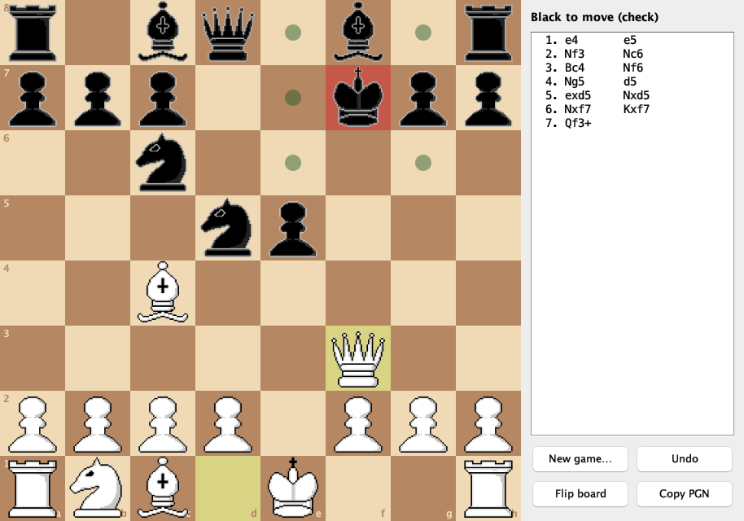

# Java Chess

[](https://github.com/naweedhah/Java-ChessGame/actions/workflows/ci.yml)

A desktop chess game in Java and Swing. You can play against a friend or against a computer
opponent at three strengths. Under the UI is a self-contained rules engine that passes the
standard **perft** correctness tests.



## Features

- Complete rules: castling (not out of, through or into check), en passant, promotion with a
  choice of piece, check, checkmate, stalemate, the fifty-move rule, threefold repetition and
  insufficient material
- **Computer opponent** (Easy / Medium / Hard) using alpha-beta search
- Click-to-move or drag-and-drop, legal-move hints, last-move and check highlighting
- Move list in standard algebraic notation (SAN), undo, flip board
- **Copy PGN**: paste the game into lichess or chess.com to analyse it

## Design

```
com.naweedh.chess
├── engine/           pure Java, no Swing, fully unit-tested
│   ├── Position      board state, FEN in/out, make/unmake move, Zobrist hash
│   ├── MoveGenerator pseudo-legal moves, then filtered by "own king not left in check"
│   ├── GameStatus    checkmate, stalemate and the draw rules
│   ├── San           algebraic notation with disambiguation (Nbd2, R1a3, Qh4e1)
│   ├── Evaluator     material + piece-square tables (separate king tables for the endgame)
│   ├── Search        negamax + alpha-beta, iterative deepening, quiescence, MVV-LVA ordering
│   └── Game          facade used by the UI: play, undo, status, PGN export
└── gui/              Swing: board rendering and input only, no chess rules
```

Key decisions:

- **The engine knows nothing about Swing.** The GUI asks `Game` for legal moves and sends back
  the squares the player chose, so every rule can be tested without a window.
- **Legality by make/unmake.** Instead of special-casing pins and checks, each pseudo-legal
  move is played, rejected if it leaves the king attacked, and undone. That is simple and
  provably correct, as the perft results show.
- **The computer thinks on a background thread** (`SwingWorker`) on a copy of the position,
  so the window stays responsive and the search can be cancelled by Undo or New game.
- **Iterative deepening under a time budget**: the engine always has a move ready, and keeps
  the best move from the deepest fully searched depth.

## Testing

```bash
mvn test
```

52 JUnit 5 tests, including:

- **Perft**: exact leaf-node counts for six standard test positions, e.g. 197,281 positions at
  depth 4 from the start and 97,862 at depth 3 from "Kiwipete". Any castling, en passant,
  promotion or pin bug changes these numbers.
- Rules: fool's mate, stalemate, threefold repetition, the fifty-move rule, insufficient material,
  castling through check, en passant that would expose the king, under-promotion, undo
- Notation: SAN disambiguation, check and mate suffixes, PGN export
- Search: finds mate in one and mate in two, wins a hanging queen, avoids losing its queen,
  respects its time limit

## Run it

Requires Java 17+.

```bash
mvn package
java -jar target/java-chess.jar
```

Or download `java-chess.jar` from the [Releases](https://github.com/naweedhah/Java-ChessGame/releases) page.
